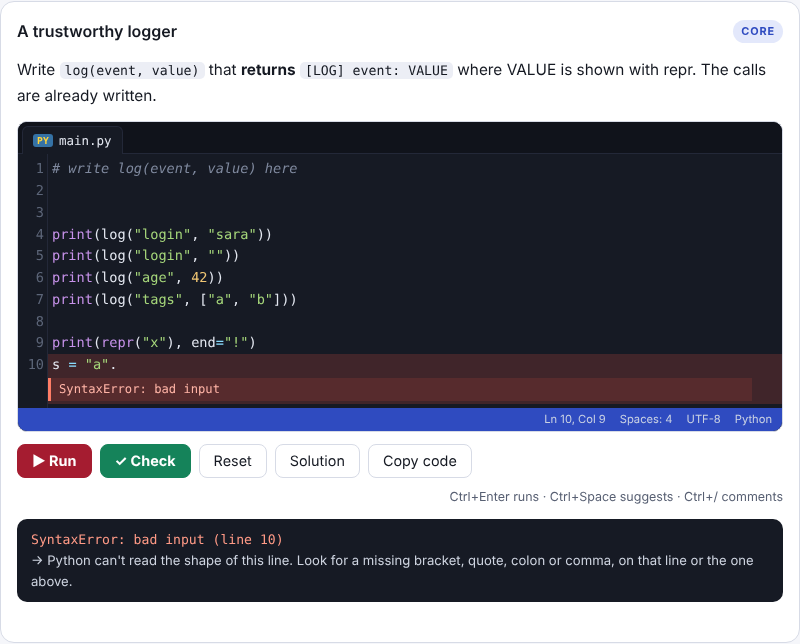

# CS50P Companion

An interactive, beginner-first study companion for Harvard's **CS50's Introduction to Programming with Python (CS50P)**.
It follows the lectures in order and adds detailed explanations, many practice exercises, real-world scenarios and a cumulative project. You can run Python directly in the browser.

> This is an independent learning aid. It is not affiliated with Harvard or CS50.
> It contains **no CS50 problem-set solutions**. All practice is original.
> For problem sets, use your own work and the CS50 Duck (cs50.ai).



## Features

| Area | What it does |
|---|---|
| **Lessons in lecture order** | Week 0 (Functions, Variables), Week 1 (Conditionals) and Week 2 (Loops) are built. Weeks 3–9 are placeholders. Each lesson links to its exact part of the lecture and the official notes. |
| **Python in the browser** | Skulpt 1.2.0 runs your code with no install. It supports `input()`, files through a virtual file system, and auto-checking. |
| **VS Code–style editor** | CodeMirror 5 with syntax highlighting, file-type detection (.py, .csv, .txt), autocomplete, signature help, hover docs, inline error highlighting, move or duplicate line, and file tabs. |
| **Exercise types** | Coded exercises with tests (183), quizzes, prediction drills, Parsons (arrange the lines), fill in the blanks, find the bug, and an anatomy explorer. |
| **Real gating** | A lesson unlocks only when every exercise in the previous one passes. A week can also be unlocked by passing its placement test. |
| **3-level hints** | (1) the tools you need, linked to the lessons that taught them; (2) an outline of the solution with blanks; (3) an AI tutor that nudges you but never solves the exercise. |
| **Only what you've learned** | An automated concept audit (Python `ast`) checks that no exercise needs anything not yet taught. |
| **Study method** | A Pomodoro focus timer, a spaced-review queue (1, 3, 7, 14… days), checklists and a long-term learning plan. |
| **Pocket Ledger project** | A personal-finance app built across the weeks. Each part uses only that week's concepts. |
| **Responsive** | Laptop, tablet and phone, with a mobile menu. |
| **Progress sync** | Progress is always saved in the browser. Cross-device sync works when hosted inside Claude, or with your own backend (see HANDOFF.md). |

## Run locally

```bash
python3 -m http.server 8000   # then open http://localhost:8000
```

## Deploy

It is a single static `index.html`, so it deploys to Vercel, Netlify or GitHub Pages as is. See **HANDOFF.md → Vercel** for enabling sync and the tutor.

## License (suggested)

- Code: MIT
- Lesson content: CC BY-SA 4.0
- Code examples quoted from docs.python.org: 0BSD. Prose from the docs: PSF License, quoted briefly with attribution.
